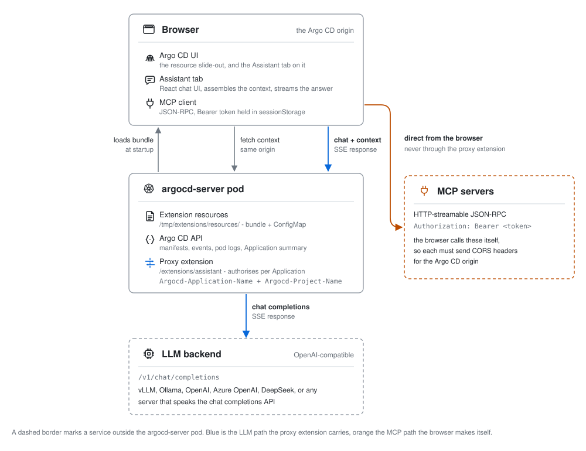

# Architecture

The Assistant is an Argo CD [UI extension](https://argo-cd.readthedocs.io/en/stable/developer-guide/extensions/ui-extensions/). It adds an **Assistant** tab to every resource's slide-out panel. When MCP servers are configured, it also adds a system-level page at `/assistant`.



## Request path

1. The installer initContainer extracts the extension into `argocd-server`, which serves it to the browser.
2. When a user opens the Assistant tab, the extension reads that resource's context from the Argo CD API.
3. Each question goes with the context and earlier messages to `/extensions/assistant`. Argo CD's proxy extension checks the user against the resource's Application. It then forwards the request to the LLM backend. With `data.baseURL` set, the browser calls that URL directly instead.
4. The backend streams its answer back as server-sent events.
5. The browser answers a call to a [built-in tool](#built-in-tools) through the Argo CD API, and sends the result back to the backend.
6. The browser calls MCP servers directly, without the proxy.

## Context

| Attachment | Sent | Content |
|---|---|---|
| Live manifest | for every resource except an Application | the object as stored in the cluster, without `managedFields` and the last-applied annotation |
| Application summary | always, in place of the manifest for an Application | source, sync and health status, sync policy, images, recent history, and any out-of-sync or unhealthy resources |
| Events | when the resource has events | Argo CD's events for the resource |
| Pods | for resources with a pod template, and for CronJobs | each pod's health, status reason, ready containers and restart count, unhealthy pods first, with the events of the first unhealthy pod |
| OutOfSync fields | when Argo CD reports the resource OutOfSync | each field whose live value differs from Argo CD's target state, with both values, and Secret fields without their values |
| Logs | after the user runs `attach` | recent lines from one container, across every pod of a workload |

The model can read more of the Application through the [built-in tools](#built-in-tools).

When a fetch fails, the attachment states the failure and the header chip shows it. The model is told that the data is missing, and does not read an empty attachment as a clean result.

Every attachment is capped by item count and by size. A cut attachment ends with a `[truncated: ...]` marker, which the prompt tells the model to treat as a fragment. Each attachment sits in an `<attachment>` block, with any `<attachment` or `<tool_result` tag in its text escaped. The system message states that text inside these blocks is data and never an instruction.

Earlier messages go with each question. The extension sends a fixed number of recent messages and caps each one. It drops the oldest when their total grows too large. History holds the visible text of earlier answers, not their tool calls.

The conversation, attached log and any MCP token stay in the tab's `sessionStorage`, per resource, until the tab closes. **New chat** clears the conversation and detaches the log.

## System prompt

The built-in prompt is `DEFAULT_SYSTEM_PROMPT` in [`src/providers/llmProvider.ts`](https://github.com/saidsef/argocd-ai-assistant/blob/main/src/providers/llmProvider.ts). It holds two sets of rules.

The accuracy rules require every claim about the cluster to come from an attachment or a tool result. General Argo CD and Kubernetes behaviour may come from the model's own knowledge. A field missing from the live manifest counts as not set, one missing from a summary counts as unknown, and every inference must be marked as one.

The answer rules give every reply one shape: a sentence that answers the question, a few bullets of quoted evidence, and a command only when the user has to act, within a word limit. They rule out headings, bold text, what-if scenarios and fixes nobody asked for.

The extension appends the attachments and a data rule to the prompt. It names and counts the built-in tools, and adds the rules for calling them. When MCP servers are configured, it also appends a list of them. When the user names a server, it adds that server's tools to the rules. A [`systemPrompt` setting](deployment/settings.md#system-prompt-override) replaces the built-in prompt, and the extension still appends these parts.

## Rendering

The chat renders each reply as Markdown. marked converts the reply to HTML, and DOMPurify then keeps only the tags and attributes that Markdown produces. A reply can quote text from the cluster, such as annotations, event messages and log lines, and marked passes raw HTML through unchanged.

| Rule | Reason |
|---|---|
| Forms, inputs and images are removed. | A reply cannot draw a credential prompt or load a tracking pixel. |
| `div` and `span` are removed, and `class` survives only as a `language-*` class on `code`. | A reply cannot draw a copy button that looks like the extension's own. |
| Links point only to `http`, `https`, `mailto`, a fragment or a same-origin path. | `javascript:` and `data:` links cannot run. |
| Links to other sites open in a new tab with `rel="noopener noreferrer"`, and same-origin links stay in the tab. | The new page cannot reach the console's window, and Argo CD links navigate the console. |

The allow-list does not include `button`, because the extension adds the copy buttons and language labels after sanitising.

## Conversation commands

Each command is a message on its own.

| Command | Effect |
|---|---|
| `attach` | Starts the log flow. The user picks a container, its previous instance if it has restarted, and a number of lines up to `maximumLogLines`. The log goes with every later question until **New chat**. |
| `token` | Asks for an Argo CD API token for the MCP servers whose entry sets `token: true`. Available when `data.mcpServers` is set. |
| `cancel`, `quit` or `exit` | Leaves the current flow. |

## Built-in tools

Both pages offer read-only tools with every question, whether or not MCP servers are configured. The browser answers each call through the Argo CD API with the user's own session, and argocd-server applies the user's RBAC.

| Page | Application a call reads |
|---|---|
| Resource tab | the one the open resource belongs to, and the model cannot name another one |
| `/assistant` | the one the call names in its `application` argument, which `list_applications` helps the model find |

| Tool | Returns | Argo CD API |
|---|---|---|
| `get_current_datetime` | the current time in UTC and in the browser's time zone | none |
| `list_applications` | every Application the user can read, with its project, sync status and health, on the `/assistant` page only | `applications` |
| `get_resource` | the live manifest and recent events of any resource in the Application | `resource-tree`, `resource`, `events` |
| `get_logs` | recent log lines from a pod, or from every pod of a workload, optionally only the lines that contain a string | `resource-tree`, `logs` |
| `get_change_history` | recent deployments with each revision's commit or Helm chart details, and every resource's result in the last sync | `applications/{name}`, `revisions/{revision}/metadata`, `chartdetails` or `ocimetadata` |
| `get_resource_diff` | the fields where an OutOfSync resource differs from the target state | `applications/{name}`, `managed-resources` |

Each tool's description is its skill. It says what the tool returns, when the model should call it and what to pass. Both tool-calling modes send the description. The system message also names the built-in tools and tells the model to list every tool, MCP tools included, when the user asks which tools it has. The definitions are in [`src/providers/builtInTools.ts`](https://github.com/saidsef/argocd-ai-assistant/blob/main/src/providers/builtInTools.ts).

- `get_resource` and `get_logs` find a resource by kind and name in the Application's resource tree, which supplies the group and version. When nothing matches, the result lists the names the model could have meant.
- `get_resource` replaces every Secret value. Argo CD masks them as well.
- `get_logs` leaves the container to Kubernetes when the model does not name one. A filter searches a wider window of recent lines in each pod, because Argo CD tails each pod before it filters.
- `get_resource_diff` reads the resource's group and sync status from the Application, and skips the request for a Synced resource.

Built-in tools share the per-question budget and size caps with MCP tools. An MCP tool with the same name as a built-in tool is not offered.

## MCP servers

`data.mcpServers` in the [settings](deployment/settings.md#mcp-servers) lists the servers. The extension connects to each one over HTTP-streamable JSON-RPC when the tab opens. The browser makes these calls itself, and each server must allow requests from the Argo CD origin.

The system message always lists the configured servers, with each server's state and tool names. The model can answer questions about the servers from that list.

### Addressing a server

A question offers a server's tools only when it names the server. The extension looks for the server's short name, reported name, hostname or first hostname label as a whole word, in any case. It searches the current message and the user's previous one. Because the previous message counts, a follow-up can leave the name out:

```text
you:  docs, what does a sync wave do?        <- names "docs", its tools are offered
you:  and how do hooks interact with them?   <- names nothing, "docs" is still offered
you:  is the pod healthy?                    <- no MCP tools offered
```

The extension never scans replies for names. A question that does not name a server never calls an MCP tool.

### Short names

Each server has one short name, shown in the header badge and the welcome message. It is the first distinctive word of the name the server reports, or else of its hostname's first label. Words shorter than four characters are skipped, as are these filler words: `mcp`, `server`, `servers`, `service`, `services`, `svc`, `api`, `apis`, `tool`, `tools`, `www`, `http`, `https`, `local`, `internal`, `cluster` and `default`.

| Server | Reported name | Short name |
|---|---|---|
| `mcp.docs.example.com` | `docs-mcp-server` | `docs` |
| `searxng.internal` | none | `searxng` |
| `api.example.com` | none | `api.example.com` |

When two servers would share a short name, both fall back to their hostname, then to `host:port`, then to the full URL. The `name` field of a server entry sets the short name directly.

### Tool-calling modes

Tools go to the backend natively, as `tools` on the chat completions request. A backend that answers such a request with 400 or 422 gets the same step again, with tools described in the system message instead. The model is then asked for a `<tool>` block. When that retry succeeds, the extension stays in text mode for that backend and model until the page reloads. The `data.toolCalling` [setting](deployment/settings.md) fixes either mode.

In native mode, every tool call gets a result message, because the backend rejects a conversation with an unanswered call. That includes a call to an unknown tool, a call with invalid arguments and a call past the budget. Tool names are rewritten to letters, digits, `_` and `-`, and mapped back to the original tool. The last completion of a question sends `tool_choice: "none"`.

### Tool-call formats

In text mode, and for a native reply without native calls, the extension reads tool calls from the reply text. It accepts these shapes:

| Format | Example |
|---|---|
| Prompted tag | `<tool name="docs_search">{"query":"argo"}</tool>` |
| Prompted tag in the model's sentinel tokens | `<｜｜DSML｜｜tool name="docs_search">{"query":"argo"}</｜｜DSML｜｜tool>` |
| DeepSeek DSML | `<｜DSML｜invoke name="docs_search">`, with one `parameter` element per argument |
| Bare JSON | `{"name":"docs_search","arguments":{"query":"argo"}}`, where `tool` may replace `name`, and `args`, `input` or `parameters` may replace `arguments` |

Only a call to an advertised tool runs, and an identical repeat runs once. Bare JSON counts as a call only when nothing but a code fence follows it. An object without a tool name runs only when its keys fit exactly one tool's schema.

### Tool blocks in the stream

The chat never shows a tool block. While a reply streams, the extension shows the text before the first tool marker and holds back everything after it. A trailing `<` waits until the extension can tell whether a marker follows.

### Limits and failures

A question runs a fixed number of tools at most, and the completion after the last one cannot call another. Each tool result is capped in size, with a tighter cap when one reply runs several tools. A request to a server times out after a fixed time, and a 502 or 503 is retried with a fresh session.

When a server is unreachable, does not list any tools or fails a call, the extension logs the reason in the browser console and answers without that server's tools. A failed call, built-in or MCP, also puts a one-line notice in the chat. The extension tries a failed server again on the next question.
